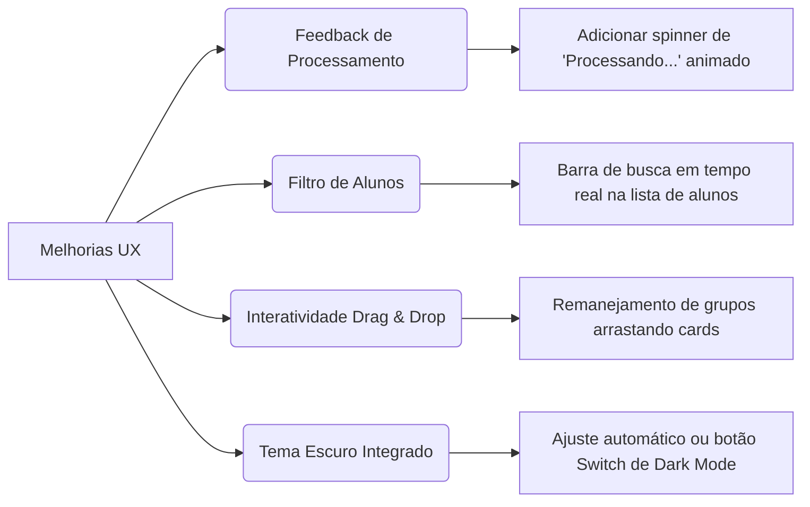

# Análise de UI/UX do AcademySync

Este documento analisa a **Interface do Usuário (UI)** e a **Experiência do Usuário (UX)** do **AcademySync**, avaliando a utilidade do design atual para o público-alvo e sugerindo melhorias para tornar o produto ainda mais premium, intuitivo e eficiente.

---

## 1. Descrição do Design System e Padrões de UI

O AcademySync utiliza um design de interface moderno, limpo e baseado em componentes bem definidos no arquivo [style.css](file:///c:/Users/victo/OneDrive/Documents/Edge/AcademySync/edgesync/gerador_grupos/static/style.css).

### Paleta de Cores e Hierarquia Visual
A interface baseia-se em cores funcionais que transmitem o status de cada ação:
* **Cor Primária (`#3498db` - Azul):** Usada para elementos de navegação, etapas principais, links e ações de processamento. Transmite confiança e profissionalismo acadêmico.
* **Cor Secundária (`#2c3e50` - Azul Escuro Slate):** Utilizada para títulos, cabeçalhos de seções e botões neutros, criando um contraste elegante e legível.
* **Cor de Sucesso (`#2ecc71` - Verde):** Aplicada em botões de geração de grupos e mensagens de sucesso, indicando que uma operação foi concluída de forma positiva.
* **Cor de Alerta (`#f39c12` - Laranja):** Usada em badges de horários e nos resultados, chamando a atenção do usuário para as áreas de saída do sistema.
* **Cor de Perigo (`#e74c3c` - Vermelho):** Utilizada para botões de limpeza de dados ("Limpar PDFs") e alertas de erro, servindo como uma barreira visual para ações destrutivas.

### Layout e Estrutura de Componentes
O design é construído com base em:
1. **Cards Independentes:** As seções da página são divididas em cartões brancos com cantos arredondados (`border-radius: 8px`) e sombras sutis (`box-shadow`), o que organiza as informações de forma limpa e evita a sobrecarga visual.
2. **Indicadores de Etapa (Step Indicators):** Círculos numerados coloridos (1 e 2) que orientam visualmente o usuário através do fluxo linear de tarefas (Carregar PDFs $\rightarrow$ Formar Grupos).
3. **Modais Dinâmicos (Popups):** Utilizados para visualizar a agenda individual de cada aluno de forma assíncrona (via AJAX), evitando que o coordenador precise sair da página principal ou recarregá-la.
4. **Elementos de Feedback Rápido:** Barras de progresso visuais com gradientes que demonstram a porcentagem de tempo livre dos alunos nos rankings.

---

## 2. Avaliação de UX: O Sistema é Útil para o Público-Alvo?

O **público-alvo principal** do AcademySync é formado por **coordenadores pedagógicos, administradores de redes de ensino, tutores e assistentes administrativos**. 

Abaixo, analisamos como as escolhas de UX respondem às principais dores desse público:

### Dor 1: Excesso de arquivos e dificuldade em organizar o fluxo
* **Como a UX resolve:** A tela principal é organizada de maneira linear. O coordenador sabe que não pode gerar grupos sem antes completar a "Etapa 1" (Carregar PDFs). O componente de drag-and-drop de arquivos facilita o envio simultâneo de múltiplos documentos, reduzindo cliques desnecessários.
* **Avaliação:** **Excelente.** A separação lógica por etapas diminui a curva de aprendizado para novos coordenadores.

### Dor 2: Alocação errada de alunos e dificuldade em encontrar janelas livres
* **Como a UX resolve:** 
  * O **Ranking de Disponibilidade** mostra imediatamente quais alunos são "críticos" (com poucas horas livres), alertando o coordenador a prestar atenção redobrada a eles.
  * O sistema de **Sugestões Inteligentes** acoplado ao card de cada membro do grupo resolve a dor mais complexa: em vez de o coordenador testar manualmente quem pode ir para onde, o sistema exibe botões prontos como *"Mover para Grupo 3"* ou *"Trocar com Aluno X"*. O motor matemático valida as disponibilidades em tempo real antes de mostrar a opção.
* **Avaliação:** **Altamente Útil.** Reduz a carga cognitiva do coordenador de "fazer cálculos e verificar calendários" para apenas "clicar e confirmar".

### Dor 3: Comunicação de resultados com alunos e equipes
* **Como a UX resolve:** Os botões de exportação rápida para **CSV** e **PDF** estão localizados no topo do painel de resultados, oferecendo soluções prontas para manipulação em planilhas ou impressão direta.
* **Avaliação:** **Muito Bom.** Agiliza a etapa final de distribuição dos grupos formados.

---

## 3. Análise Detalhada de Usabilidade (Pontos Fortes e Pontos Fracos)

| Aspecto | Ponto Forte | Ponto Fraco / Oportunidade de Melhoria |
| :--- | :--- | :--- |
| **Envio de Dados** | Permite seleção múltipla de arquivos PDF com validação rápida de formato. | A conversão e leitura de PDFs é um processo pesado. A falta de um indicador visual de carregamento contínuo (spinner) pode fazer o usuário pensar que o sistema travou. |
| **Navegação** | Layout em página única (*single-page layout*) focado na produtividade. | Caso a lista de alunos seja muito grande (ex: 80+ alunos), a seção de visualização individual gera uma rolagem vertical excessiva na tela. |
| **Ajustes de Grupos** | As sugestões de troca 1-para-1 impedem a criação involuntária de conflitos de horário. | A remoção de um aluno o envia para um "banco de removidos", mas a recolocação exige o uso de um formulário manual separado no final da página, quebrando o fluxo de arrastar e soltar. |
| **Acessibilidade** | Cores contrastantes e tipografia limpa que facilitam a leitura rápida. | Elementos interativos como o botão de sugestões (`
`) podem ser difíceis de operar em dispositivos móveis ou telas menores de tablets. |

---

## 4. Recomendações de Melhoria de UI/UX (Roteiro de Evolução)

Para transformar a interface atual em uma experiência ainda mais premium e satisfatória, sugerimos a implementação das seguintes melhorias de usabilidade:

### 1. Indicadores de Estado de Carregamento (Loading States)
* **Ação:** Adicionar uma animação (spinner de rotação ou barra de progresso ativa) no botão "Processar PDFs" e "Gerar Grupos". 
* **Impacto:** Reduz a ansiedade do usuário durante o processamento de grandes lotes de arquivos, deixando claro que o sistema está trabalhando em segundo plano.

### 2. Busca e Filtro Rápido de Estudantes
* **Ação:** Incluir uma pequena barra de pesquisa de texto acima da lista de alunos na "Visualização Individual".
* **Impacto:** Permite que coordenadores encontrem rapidamente um estudante específico para verificar sua grade de horários, sem ter que varrer a lista completa de nomes visualmente.

### 3. Melhoria na Ação de Remanejamento (Interatividade Avançada)
* **Ação:** Substituir ou complementar os botões de troca estáticos por uma interface de arrastar e soltar (Drag and Drop), permitindo arrastar o bloco de um aluno de um grupo para o outro.
* **Impacto:** Eleva o nível de usabilidade do app para um patamar de ferramentas de gestão modernas (como Trello ou Miro), tornando a reorganização de grupos extremamente dinâmica e divertida.

### 4. Switch de Modo Escuro (Dark Mode)
* **Ação:** Implementar um botão de alternância (Toggle) para modo claro/escuro persistido no navegador.
* **Impacto:** Melhora o conforto visual para coordenadores que utilizam o sistema por longas horas, especialmente em ambientes de trabalho noturnos.
