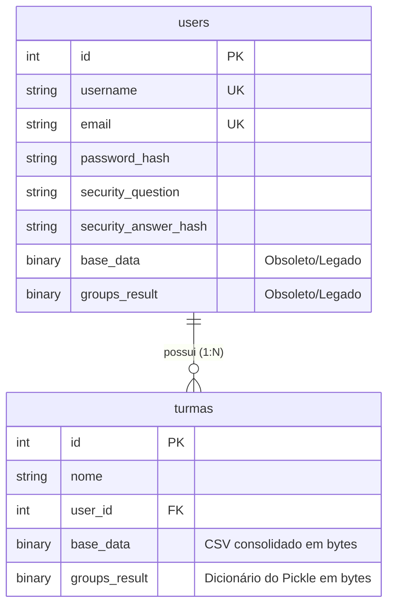

# Estrutura do Banco de Dados e Relacionamentos — AcademySync

Este documento detalha o esquema de banco de dados do **AcademySync**, incluindo tabelas, colunas, tipos de dados, chaves estrangeiras, relacionamentos e serialização de dados complexos.

---

## 📊 Diagrama de Entidade-Relacionamento (ERD)



---

## 🗂️ Detalhamento das Tabelas

O backend utiliza **Flask-SQLAlchemy** para mapear as classes Python para tabelas relacionais do SQLite (em ambiente local) ou PostgreSQL (em produção no Neon).

### 1. Tabela `users` (Classe `User`)
Guarda as credenciais, dados de recuperação autônoma e associação de turmas dos usuários administradores.

| Campo | Tipo SQL | Restrições | Descrição / Detalhes |
| :--- | :--- | :--- | :--- |
| **`id`** | `INTEGER` | Chave Primária | Identificador único incremental do usuário. |
| **`username`** | `VARCHAR(80)` | Único, Não Nulo | Nome de exibição e de identificação no login. |
| **`email`** | `VARCHAR(120)` | Único, Não Nulo | E-mail corporativo cadastrado (usado para login/recuperação). |
| **`password_hash`** | `VARCHAR(256)` | Não Nulo | Hash seguro da senha de acesso (gerado por `PBKDF2`). |
| **`security_question`** | `VARCHAR(256)` | Nulo permitido | Pergunta de segurança (padrão ou personalizada) para redefinição autônoma. |
| **`security_answer_hash`**| `VARCHAR(256)` | Nulo permitido | Hash da resposta à pergunta de segurança (salva em minúsculas e sem espaços). |
| **`base_data`** | `BLOB` / `BYTEA` | Nulo permitido | *Legado:* Armazenava a base antiga de CSV. Atualmente é limpo e migrado para `turmas`. |
| **`groups_result`** | `BLOB` / `BYTEA` | Nulo permitido | *Legado:* Armazenava os grupos antigos. Atualmente é limpo e migrado para `turmas`. |

---

### 2. Tabela `turmas` (Classe `Turma`)
Representa cada workspace independente criado por um usuário. Os dados e resultados de cada turma são segregados.

| Campo | Tipo SQL | Restrições | Descrição / Detalhes |
| :--- | :--- | :--- | :--- |
| **`id`** | `INTEGER` | Chave Primária | Identificador único incremental da turma. |
| **`nome`** | `VARCHAR(120)` | Não Nulo | Nome personalizado para identificar a turma/workspace (ex: "Turma A 2026"). |
| **`user_id`** | `INTEGER` | Chave Estrangeira | Associa a turma ao usuário proprietário (`users.id`). Não Nulo. |
| **`base_data`** | `BLOB` / `BYTEA` | Nulo permitido | Contém a grade consolidada dos alunos em formato CSV binário (codificado em UTF-8). |
| **`groups_result`** | `BLOB` / `BYTEA` | Nulo permitido | Dicionário serializado via `Pickle` contendo o resultado da formação de grupos. |

---

## 🔗 Relacionamentos e Integridade Referencial

### 1. Relação Usuário ⇄ Turmas (`1 : N`)
- Cada **Usuário** pode possuir zero, uma ou várias **Turmas**.
- Cada **Turma** pertence obrigatoriamente a um único **Usuário**.
- **Definição de Relacionamento no ORM:**
  ```python
  user = db.relationship('User', backref=db.backref('turmas', lazy=True, cascade="all, delete-orphan"))
  ```
- **Cascata (`cascade="all, delete-orphan"`)**: Se um usuário for excluído do banco de dados, todas as turmas associadas a ele serão excluídas automaticamente em cascata para evitar registros órfãos.

---

## 💾 Serialização de Dados Complexos (BLOBs)

Para suportar bancos de dados em nuvem efêmeros (onde arquivos salvos localmente em disco são deletados ao reiniciar a máquina), o sistema persiste estruturas complexas diretamente em colunas binárias (`LargeBinary`):

### 1. `base_data` (CSV de Alunos)
- Os uploads de atestados geram um DataFrame consolidado do Pandas.
- Esse DataFrame é convertido em memória para uma string CSV UTF-8 e salvo no banco de dados como bytes:
  ```python
  csv_buffer = BytesIO()
  df.to_csv(csv_buffer, index=False, encoding='utf-8')
  turma.base_data = csv_buffer.getvalue()
  ```
- Para leitura, o processo é invertido:
  ```python
  df = pd.read_csv(BytesIO(turma.base_data))
  ```

### 2. `groups_result` (Estrutura de Grupos Formados)
- Após a execução do algoritmo de formação de grupos, os dados completos do processamento (grupos, slots, disponibilidades e não alocados) são agregados em um dicionário Python e serializados com `pickle`:
  ```python
  turma.groups_result = pickle.dumps(resultado_dict)
  ```
- O dicionário serializado possui a seguinte estrutura de chaves:
  - **`grupos`**: Lista de dicionários representando cada grupo:
    ```python
    [
        {
            "Grupo": 1,
            "Dia": "Seg",
            "Horário": "Manhã (08h-12h)",
            "Membros": ["Nome_Aluno_1", "Nome_Aluno_2"]
        },
        ...
    ]
    ```
  - **`slots_por_aluno`**: Mapeamento de quais slots cada aluno tem disponível.
  - **`mapa_disponibilidade`**: Mapeamento de slots para conjuntos de alunos disponíveis.
  - **`alunos_sem_grupo`**: Lista contendo alunos não alocados por incompatibilidade absoluta de horários.
  - **`blocos`**: Definição dos blocos de horários configurados na geração.

---

## 🔄 Lógica de Migração de Dados Dinâmica

Ao iniciar, o backend executa migrações dinâmicas automáticas dentro do contexto da aplicação para garantir que o esquema do banco esteja atualizado:

1. **Criação de Tabelas:** Executa `db.create_all()` para gerar tabelas inexistentes.
2. **Coluna de Pergunta de Segurança:** Tenta rodar `ALTER TABLE users ADD COLUMN security_question` e `security_answer_hash` caso a versão do banco seja antiga.
3. **Migração de Dados Legados:** Caso existam dados binários (`base_data`/`groups_result`) na tabela `users` (da arquitetura antiga que não possuía múltiplos workspaces), o sistema cria uma "Turma Principal" associada ao usuário, transfere os dados binários para ela e limpa os campos obsoletos da tabela `users`.
