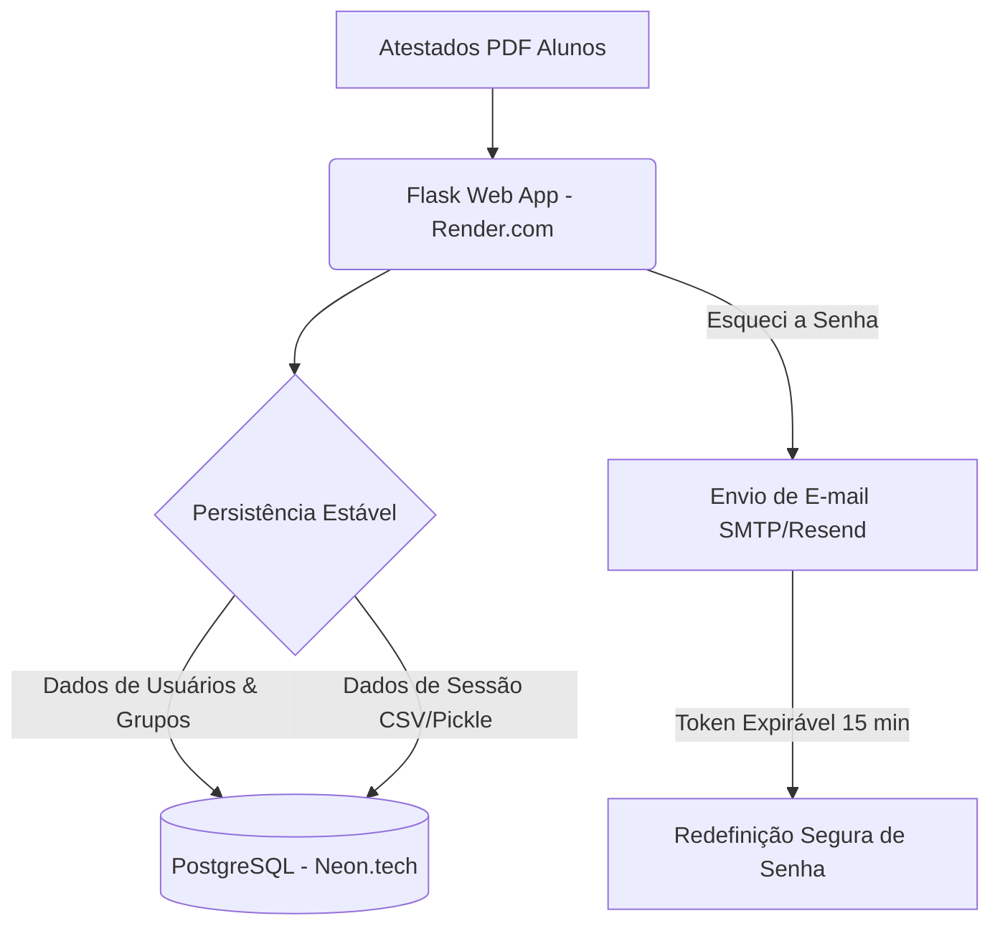

# AcademySync: Funcionamento, Proposta e Finalidade

Este documento apresenta uma visão detalhada do sistema **AcademySync**, explicando seu propósito, suas funcionalidades atuais e os planos de melhoria estrutural para sua migração definitiva. Ele foi desenvolvido com o foco tanto em coordenadores de ensino (que utilizam o sistema no dia a dia) quanto em desenvolvedores (que mantêm e evoluem a base de código).

---

## 1. Proposta e Finalidade do Projeto

### O Problema
Em programas de mentoria, monitoria ou acompanhamento acadêmico (como a *Edge Academy*), coordenadores enfrentam um grande desafio manual: **organizar grupos de alunos com base em suas grades horárias escolares/universitárias**. 
* Cada aluno possui atestados de matrícula ou comprovantes de horários em formatos PDF distintos.
* Cruzar manualmente as grades de dezenas ou centenas de alunos para encontrar janelas comuns de horário é um processo demorado, cansativo e suscetível a erros.
* Qualquer mudança posterior de aluno (troca de grupo) pode quebrar as restrições de horário, gerando novos conflitos.

### A Proposta do AcademySync
O **AcademySync** automatiza e centraliza todo esse fluxo de trabalho. A proposta do sistema é:
1. **Extrair automaticamente** os horários de aula dos alunos a partir de arquivos PDF enviados em lote.
2. **Consolidar os dados** em uma matriz de disponibilidade semanal para cada estudante.
3. **Gerar grupos equilibrados automaticamente** de acordo com parâmetros dinâmicos (tamanho do grupo e blocos de horário preferidos).
4. **Facilitar remanejamentos** por meio de um sistema de sugestões inteligentes que calcula matematicamente trocas compatíveis, impedindo que coordenadores criem conflitos de agenda por engano.

---

## 2. Funcionamento Atual do Sistema

O sistema é estruturado como uma aplicação web Python (utilizando **Flask** ou protótipos em **Streamlit**). O fluxo operacional atual segue as etapas descritas abaixo:

### A. Fluxo de Acesso e Autenticação
* **Registro e Login:** Usuários (coordenadores) criam contas e efetuam login com segurança. As senhas são criptografadas utilizando `werkzeug.security`.
* **Segurança de Sessão:** Cada coordenador possui um diretório próprio e temporário para seus arquivos de dados (`session_data/<username>/`). Isso garante que os dados processados por um coordenador não se misturem com os de outro.
* **Recuperação de Senha:** Atualmente, o sistema possui uma tela de "Esqueci a Senha" que gera uma nova credencial temporária e a exibe diretamente na interface (uma solução temporária antes da migração para envio de e-mails reais).

### B. Upload e Processamento de PDFs (Etapa 1)
* O coordenador realiza o envio em lote dos comprovantes em PDF dos alunos.
* O motor de leitura (`services/pdf_reader.py` e `services/pdf_parser.py`) faz a varredura do texto dos arquivos, mapeando as matérias matriculadas em cada dia da semana (Segunda a Sábado) e faixa de horário.
* O sistema compila esses dados em um formato padronizado (CSV consolidado), onde cada linha representa se o aluno está ocupado ou livre em determinado horário.

### C. Visualização de Disponibilidade
* **Visualização Individual:** Permite que o coordenador clique no nome de qualquer aluno para abrir um modal contendo a sua grade horária semanal completa, destacando os horários livres e ocupados.
* **Agenda Geral Completa:** Apresenta uma tabela de calor mostrando o total de alunos disponíveis em cada dia e hora da semana, ajudando a identificar quais são os melhores horários globais para marcar reuniões ou monitorias.
* **Ranking de Disponibilidade:** Divide os alunos em dois grupos: os "Mais Disponíveis" e os "Menos Disponíveis" (críticos). Isso permite dar prioridade de alocação aos alunos com agendas mais apertadas.

### D. Geração de Grupos de Acompanhamento (Etapa 2)
O coordenador define:
1. O número total de grupos de estudo desejado.
2. Os **Blocos de Horários** viáveis (ex: Manhã das 08:00 às 11:00, Tarde das 14:00 às 17:00, etc.) e os dias correspondentes.

O algoritmo interno (`services/group_generator.py`) realiza os seguintes passos:
* **Mapeamento de Slots:** Identifica quais alunos estão livres em cada bloco de horário/dia configurado.
* **Alocação Heurística:** Prioriza colocar primeiro nos grupos os alunos que possuem menor disponibilidade geral (para evitar que fiquem sem opções no final).
* **Balanceamento de Tamanho:** Ajusta a quantidade de membros por grupo para que fiquem equilibrados (diferença máxima de 1 aluno entre grupos).
* **Tratamento de Exceções:** Identifica e lista claramente os alunos que não puderam ser encaixados por total incompatibilidade de horários.

### E. Remanejamento e Sugestões Inteligentes
Caso o coordenador queira ajustar manualmente os grupos formados, o sistema oferece:
* **Sugestões de Movimentação:** Indica para quais outros grupos aquele aluno pode ser transferido diretamente sem gerar conflitos com sua grade acadêmica.
* **Sugestões de Trocas 1-para-1:** Sugere trocas entre o Aluno A (do Grupo X) e o Aluno B (do Grupo Y), certificando-se de que o Aluno A pode frequentar o horário do Grupo Y e o Aluno B pode frequentar o horário do Grupo X.
* **Troca Manual & Recolocação:** Permite selecionar alunos específicos para movimentações forçadas ou recolocar alunos do banco de "não alocados".

### F. Exportação de Resultados
* Download dos grupos formados em formato **CSV** (para abertura no Excel).
* Download de um relatório formatado em **PDF** (gerado com ReportLab), pronto para compartilhamento com as equipes.

---

## 3. Proposta de Melhorias e Migração (Infraestrutura Estável)

Atualmente, o protótipo do sistema armazena informações localmente no servidor (`users.json` e arquivos CSV/Pickle temporários em disco). Em plataformas de nuvem gratuitas com discos efêmeros (como Streamlit Cloud ou Render Free tier), as atualizações automáticas diárias do servidor limpam esses arquivos locais, causando perda constante de dados dos usuários e grupos.

Para transformar o AcademySync em uma ferramenta de nível profissional, o plano de implementação prevê a seguinte reestruturação:

### 1. Migração para Banco de Dados Relacional (Neon.tech)
* **Substituição do `users.json`:** As contas, senhas criptografadas (hashes) e permissões serão salvas em tabelas SQL estruturadas.
* **Fim da Perda de Dados de Sessão:** Em vez de salvar arquivos de grade `.csv` e `.pkl` no disco local efêmero, os dados correspondentes serão salvos como campos binários (`LargeBinary` / `BLOB`) no banco de dados, vinculados a cada usuário. Isso garante que a sessão persista mesmo que o servidor web reinicie.
* **Banco Local Fallback:** Em ambiente de desenvolvimento local, o sistema utilizará um banco SQLite (`sqlite:///usuarios.db`) de forma transparente, facilitando testes offline.

### 2. Hospedagem Profissional e Estável (Render.com)
* A aplicação Flask será publicada na plataforma Render.com, conectada ao repositório GitHub do projeto.
* A execução será realizada via servidor WSGI de produção (**Gunicorn**), garantindo suporte a múltiplos acessos simultâneos e criptografia HTTPS (SSL) nativa de forma gratuita.

### 3. Sistema SMTP de Recuperação de Senha por E-mail
* Integração com serviço SMTP gratuito (como **Resend.com** ou Senhas de App do **Gmail**).
* Geração de tokens de segurança expiráveis (15 minutos) com a biblioteca `itsdangerous`. O link de recuperação será enviado para o e-mail cadastrado do coordenador, garantindo total privacidade e segurança contra acessos não autorizados.
