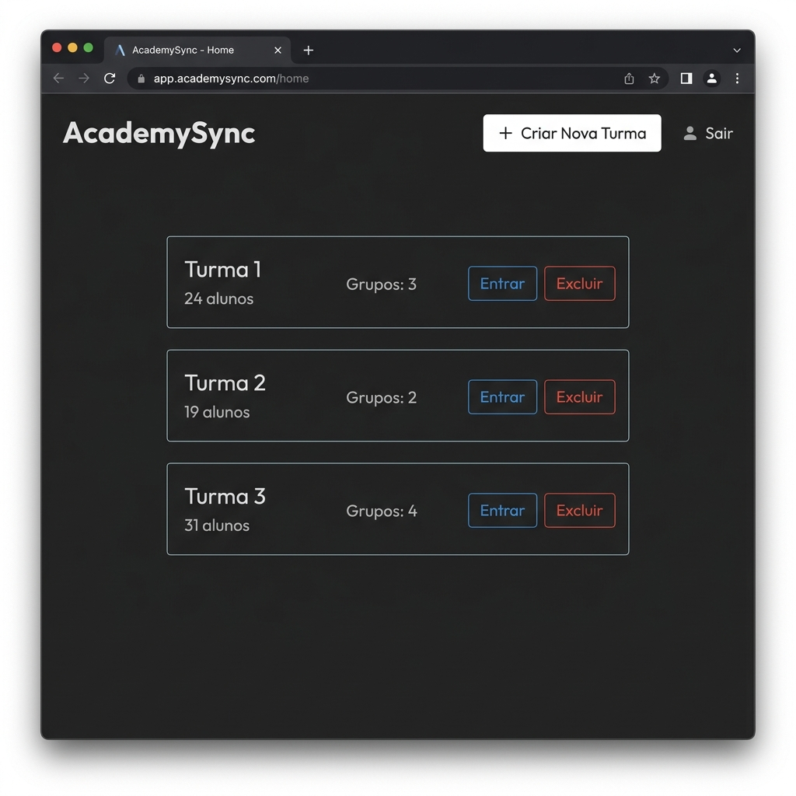
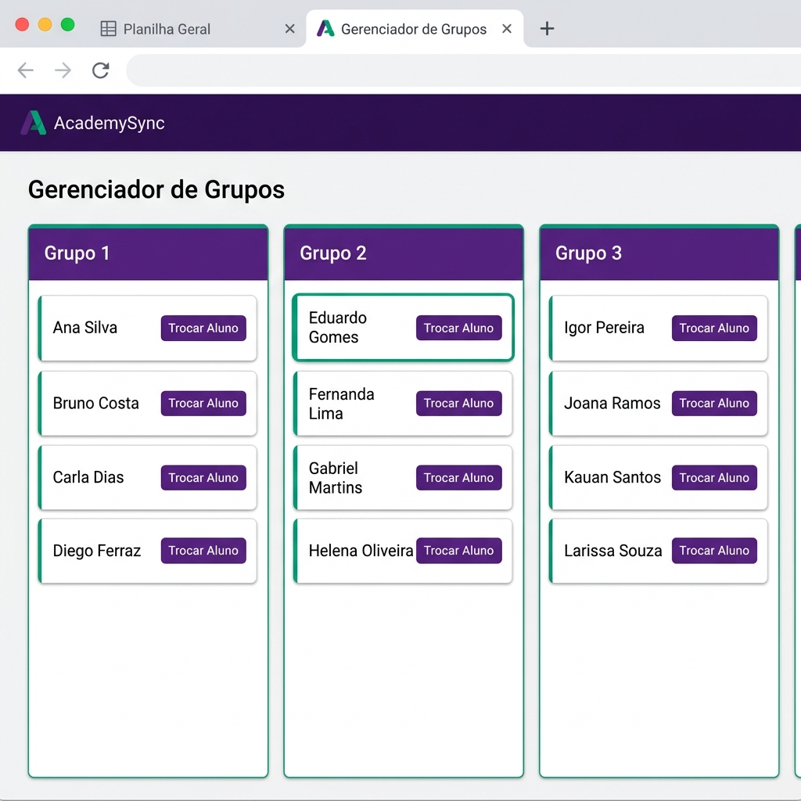
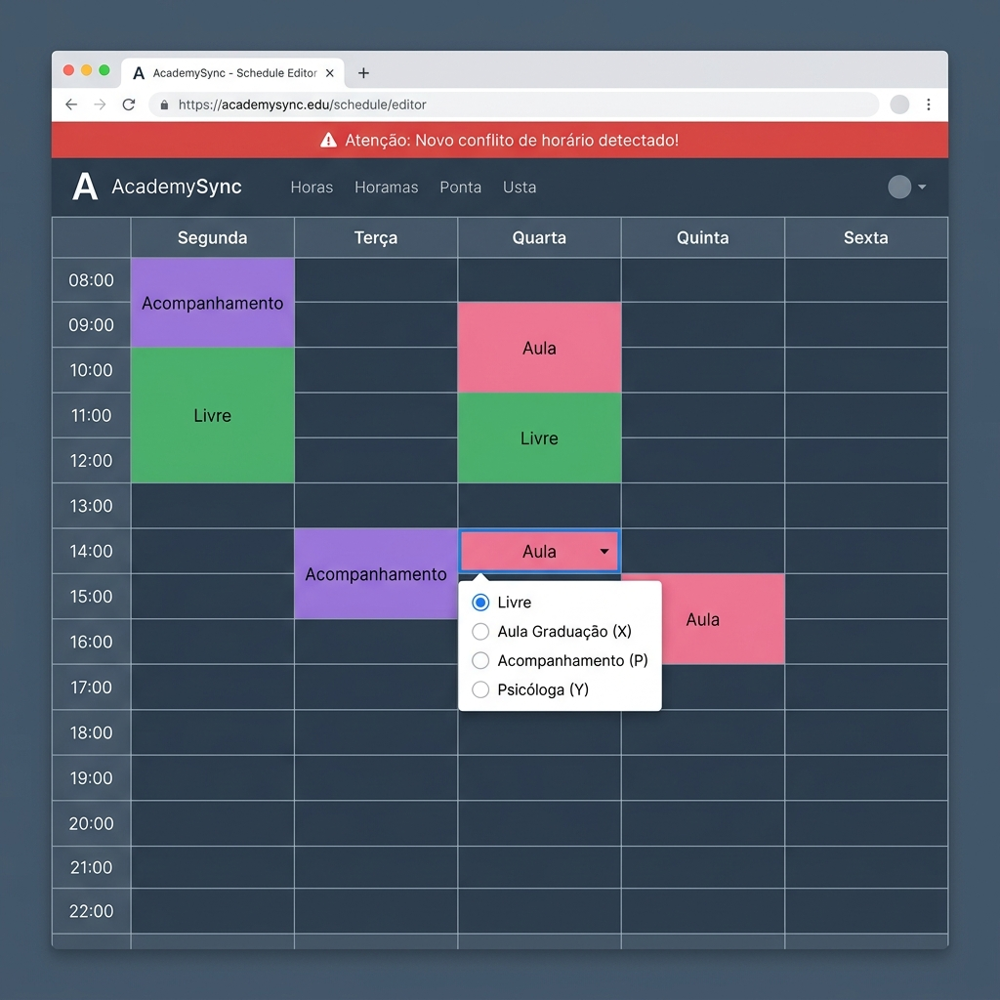
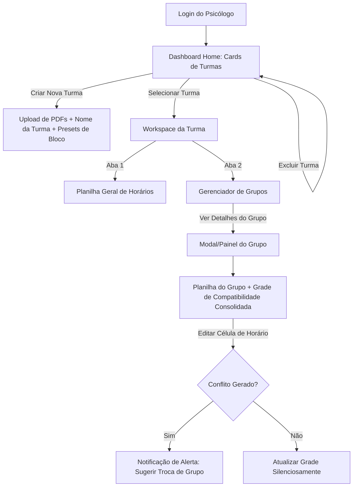

# Especificação da "Nova Cara" do AcademySync

Este documento consolida a nova arquitetura de **UI/UX (Interface e Experiência do Usuário)** e o plano de desenvolvimento técnico para o **AcademySync**, redesenhado especificamente para atender à rotina dos psicólogos da Edge Academy na criação de grupos de imersão.

---

## 📸 Maquetes Conceituais (Mockups)

### 🟢 1. Painel de Controle de Turmas (Dashboard Home)
Uma tela inicial limpa que exibe as turmas cadastradas em formato de cartões (cards), contendo o nome da turma, quantidade de alunos, quantidade de grupos e botões para entrar e excluir. Há também um botão visível de `+ Nova Turma`.

---

### 🔵 2. Gerenciador de Grupos da Turma (Visualização em Kanban)
Exibição dos grupos formados em cartões lado a lado (estilo colunas Kanban), mostrando os integrantes de cada grupo, quantidade de alunos e opções para remanejamento rápido.

---

### 🟡 3. Editor de Planilha & Detecção de Conflitos (Spreadsheet Editor & Alertas)
Uma tabela estilo Excel para edição direta de horários dos alunos por meio de um popover de seleção, mostrando a notificação flutuante de novo conflito de horário gerado no topo da tela.

---

## 🧭 1. Fluxo de Navegação e Arquitetura do Sistema

### 🏠 A. Tela Inicial (Dashboard Home)
Assim que o psicólogo faz o login, ele se depara com um painel de controle limpo exibindo suas turmas ativas.
* **Componentes:**
  * Grid de cartões (cards) de Turmas. Cada card mostra o **Nome da Turma** (ex: "Imersão 2026.1 - Dev"), **Quantidade de Talentos** (ex: "24 alunos"), e **Número de Grupos** formados.
  * Botão em destaque: `+ Nova Turma`. Abre uma interface limpa para nomear a turma e fazer o upload em lote dos PDFs.
  * Botão de lixeira (`Excluir`) em cada card para apagar os dados daquela turma do banco de dados quando necessário.

### 💼 B. Workspace da Turma (Espaço de Trabalho Tabulado)
Ao entrar em uma turma, o cabeçalho exibe o nome da turma ativa e disponibiliza duas abas (Tabs) em tela cheia para otimizar o espaço de trabalho:

#### 1. Aba: Planilha Geral de Horários
* Exibe a grade de horários de **todos os alunos daquela turma** juntos, em formato idêntico ao Excel.
* Linhas = Alunos; Colunas = Dias da Semana subdivididos em horas.
* **Legenda Visual:**
  * Verde Esmeralda: Livre para imersões.
  * Rosa Carmesim (`X`): Aulas de Graduação (importado dos PDFs).
  * Roxo (`P`): Acompanhamentos Individuais.
  * Cores Customizadas: Novas marcações definidas pelo psicólogo.

#### 2. Aba: Gerenciador de Grupos
* Apresenta os grupos gerados automaticamente em cartões lado a lado (estilo Kanban).
* Cada card de grupo mostra o nome do grupo, total de integrantes e botões de ação rápida.
* **Lógica de Troca Dinâmica:** O psicólogo pode selecionar um aluno e o sistema destaca visualmente outros grupos onde esse aluno tem horários livres compatíveis, sugerindo a melhor troca.

### 🔍 C. Painel de Detalhes do Grupo
Ao abrir um grupo específico no Gerenciador de Grupos, exibe-se uma visão combinada:
1. **Planilha Individual do Grupo:** Apenas os horários dos integrantes daquele grupo, facilitando a visualização rápida.
2. **Grade Consolidada de Sincronia:** Uma mini-grade que sobrepõe os calendários de todos os membros do grupo. Os horários onde **todos** estão livres ficam em verde brilhante, indicando as janelas exatas para agendar a imersão.

---

## 🎨 2. Design System & Tema Visual (Premium Híbrido)

A interface adota uma estética limpa, moderna e focado em dados legíveis.

* **Tipografia:** Fonte principal **Outfit** (via Google Fonts), transmitindo modernidade e fluidez.
* **Esquema de Cores:**
  * *Fundo:* Slate Gray (Cinza ardósia claro para o modo claro, grafite escuro com transparências de vidro para o modo escuro).
  * *Disponível (Free):* Verde Esmeralda suave (`#2ecc71`).
  * *Bloqueado (Classe/Conflito):* Vermelho Carmesim (`#e74c3c`).
  * *Acompanhamento Individual:* Roxo Neon (`#9b59b6`).
  * *Acentos de Destaque:* Azul Royal (`#3498db`) e Roxo profundo para botões e abas ativas.
* **Dark/Light Mode:** Switch manual no canto superior direito da barra de navegação, salvando a preferência do psicólogo para os próximos acessos.

---

## ⚡ 3. Usabilidade & Mecânicas de Edição

### 💬 A. Popover de Edição de Horários
Ao clicar em qualquer célula de horário na **Planilha Geral** ou na **Planilha do Grupo**, um pequeno menu flutuante (Popover) aparece com as opções:
1. Marcar como **Livre** (Limpar célula).
2. Marcar como **Aula de Graduação** (`X`).
3. Marcar como **Acompanhamento** (`P`).
4. **Novo Compromisso Customizado:** Permite digitar um nome (ex: "Psicóloga"), definir uma Sigla de 1 letra (ex: `Y`), escolher uma cor em um seletor e marcar um switch: *"Bloquear este horário para agrupamento?"*.
   * *Persistência:* Ao criar, esse compromisso personalizado é salvo no perfil do usuário e fica disponível para uso em qualquer célula ou turma futura.

### 🔔 B. Notificação de Nova Incompatibilidade
Se o psicólogo editar a célula de um aluno adicionando um compromisso bloqueante em um horário que colide com a agenda atual do seu grupo:
* O sistema salva a alteração no banco de dados.
* Exibe uma **notificação de alerta no topo da tela** (Toast Alert): 
  > ⚠️ *Atenção: O aluno **Alice Silva** agora possui um conflito com o horário do **Grupo 1**. Sugerimos movê-la para o **Grupo 3** ou realizar uma troca.*
* O card do grupo no gerenciador ganha uma borda vermelha pulsante indicando que precisa de atenção.

---

## 💾 4. Infraestrutura e Persistência de Dados

Migraremos o sistema do armazenamento temporário em disco para a nuvem:

* **Banco de Dados:** **PostgreSQL** hospedado na **Neon.tech** (gratuito e sem limite de conexões simultâneas).
* **Hospedagem:** **Render.com** configurado para ler diretamente do repositório Git, executando via `gunicorn`.
* **Segurança:** Criptografia de senhas com `scrypt`, tokens expiráveis de 15 minutos para recuperação de senha real via e-mail corporativo do Academy usando o SMTP configurado.

---

## 🛠️ 5. Roteiro de Implementação Técnica

Para realizar essa transformação no projeto atual, seguiremos o seguinte roteiro de desenvolvimento:

### 🟩 Fase 1: Banco de Dados & Autenticação (Persistência)
- [ ] Criar a conta no **Neon.tech** e configurar o projeto PostgreSQL.
- [ ] Instalar as dependências `Flask-SQLAlchemy` e `psycopg2-binary` no [requirements.txt](file:///c:/Users/victo/OneDrive/Documents/Edge/AcademySync/edgesync/gerador_grupos/requirements.txt).
- [ ] Criar o modelo `User` e o novo modelo `Turma` e `Aluno` no banco de dados:
  * `Turma`: id, nome, user_id, num_grupos, blocos_horario (JSON), data_criacao.
  * `Aluno`: id, nome, turma_id, compromissos (JSON de horários e siglas).
  * `Grupo`: id, numero, turma_id, dia, horario, membros (relacionamento/lista de alunos).
- [ ] Atualizar rotas de Login, Registro e criar fluxo de Redefinição de Senha real via e-mail.

### 🟨 Fase 2: Backend de Gestão de Turmas
- [ ] Adaptar a rota `/` para servir como a API do **Dashboard Home** se o usuário não tiver selecionado uma turma.
- [ ] Criar rota para criar turma (`/turma/criar`) recebendo o nome e processando os PDFs iniciais salvando diretamente nos modelos `Aluno` no Postgres.
- [ ] Migrar o algoritmo de formação de grupos (`services.group_generator.formar_grupos`) para ler e salvar os resultados estruturados diretamente nas tabelas `Grupo` do banco de dados.

### 🟦 Fase 3: Desenvolvimento da Nova UI/UX (Frontend)
- [ ] Atualizar o [style.css](file:///c:/Users/victo/OneDrive/Documents/Edge/AcademySync/edgesync/gerador_grupos/static/style.css) com o novo Design System (Outfit, Slate Gray, Emerald, Crimson, Dark Mode toggles).
- [ ] Reconstruir o [index.html](file:///c:/Users/victo/OneDrive/Documents/Edge/AcademySync/edgesync/gerador_grupos/templates/index.html) para suportar o fluxo de Abas (Tabs) do workspace da turma.
- [ ] Desenvolver a tabela de **Planilha Dinâmica** usando CSS Grid / Flexbox para comportamento elástico.
- [ ] Implementar o Popover flutuante em JavaScript Puro para edição rápida de compromissos e cadastro de novos tipos salvos via Fetch API (`/salvar_compromisso`).

### 🟪 Fase 4: Inteligência de Sincronia & Alertas
- [ ] Implementar a validação automática em JS/Python: ao alterar um horário, disparar a verificação de compatibilidade com o grupo ativo do aluno.
- [ ] Integrar notificações via Toasts flutuantes na tela caso um conflito seja detectado.
- [ ] Habilitar o download de CSV e PDF formatados por turma.
